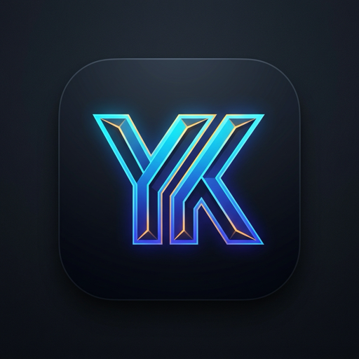

<div align="center">
  
  <h1>YK Editor</h1>
  <p>The fast, native code editor and agent workspace.</p>
  <p>Written in Rust. Batteries included.</p>
  <p><a href="#download"><strong>Download</strong></a></p>
</div>

---

YK Editor is a fast, native code editor written in Rust, with a clean, modern design and coding agents built in. YK Editor is a fork of [Wu](https://github.com/dstrml/wu) (and upstream [Zed](https://github.com/zed-industries/zed)), automatically syncing changes from upstream.

## Features

- ⚡ **Native and fast.** No Electron or webviews. Opens instantly and stays responsive on large views.
- 🍃 **Lightweight.** Lower memory footprint than VS Code and Zed. See [benchmarks](docs/memory-benchmark.md).
- 👾 **Coding agents included.** Built-in support for Claude Code, Codex, and OpenCode.
- ✨ **Beautiful by default.** Clean, modern look with a delightful UX.
- 🤫 **No account or telemetry.** Nothing to sign in to. Never sends your usage data anywhere.
- 🔄 **Automated Upstream Sync.** Automated tracking and pull integration from `dstrml/wu`.

## Download

On macOS and Linux, run:

```sh
curl -fsSL https://raw.githubusercontent.com/yathink3/yk-editor/main/script/install.sh | sh
```

For Windows, download the [installer](https://github.com/yathink3/yk-editor/releases/latest/download/YK-Editor-x86_64.exe).

<details>
<summary>Or install manually</summary>

- [macOS (Apple Silicon)](https://github.com/yathink3/yk-editor/releases/latest/download/YK-Editor-aarch64.dmg)
- [macOS (Intel)](https://github.com/yathink3/yk-editor/releases/latest/download/YK-Editor-x86_64.dmg)
- [Linux x86-64](https://github.com/yathink3/yk-editor/releases/latest/download/yk-editor-linux-x86_64.tar.gz)
- [Linux AArch64](https://github.com/yathink3/yk-editor/releases/latest/download/yk-editor-linux-aarch64.tar.gz)

See [INSTALL.md](docs/INSTALL.md) for more.
</details>

---


## Docs

See the [Documentation](docs/INSTALL.md) for setup and usage instructions.

## Building

YK Editor builds using Cargo and the Rust toolchain:

```sh
cargo build --release
```

See [Zed development docs](https://zed.dev/docs/development) for system prerequisite packages.

## Upstream Sync

To pull and sync new changes from the upstream `dstrml/wu` repository locally:

```sh
./script/sync-upstream.sh
```

A GitHub Action (`.github/workflows/sync-wu.yml`) also runs on a recurring schedule to notify you and pull any new commits from `https://github.com/dstrml/wu`.

## Licensing

YK Editor is licensed under GPL-3.0-or-later with Apache-2.0 components where marked. See [LICENSE-GPL](./LICENSE-GPL) and [LICENSE-APACHE](./LICENSE-APACHE).

YK Editor is a derivative work of [Wu](https://github.com/dstrml/wu) and [Zed](https://github.com/zed-industries/zed) and shares the same licenses.

## Acknowledgements

Thanks to the Zed and Wu teams for building and releasing their work as open source.
